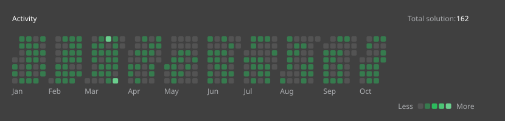

# All Submissions in 2025

## Overview

There are totally **136** questions have been solved in 2025, including **6** questions in easy, **93** questions in medium and **37** questions in hard.

Please click on the sections below to see more details for a specific month.
- [September](#september-submissions)

- [August](#august-submissions)

- [July](#july-submissions)

- [June](#june-submissions)

- [May](#may-submissions)

- [April](#april-submissions)

- [March](#march-submissions)

- [February](#february-submissions)

- [January](#january-submissions)

## September Submissions

Solved **2** questions in september:
- **0** questions in easy.
- **1** questions in medium.
- **1** questions in hard.

|   |Question Title|Difficulty|Source|
|:--|:-------------|:--------:|:-----|
|Day 3|[#3027. Find the Number of Ways to Place People II](https://leetcode.com/problems/find-the-number-of-ways-to-place-people-ii/)|Hard|[src/q_3001_3050/q3027.cc](../src/q_3001_3050/q3027.cc)|
|Day 2|[#3025. Find the Number of Ways to Place People I](https://leetcode.com/problems/find-the-number-of-ways-to-place-people-i/)|Medium|[src/q_3001_3050/q3025.cc](../src/q_3001_3050/q3025.cc)|
|Day 1||||
## August Submissions

Solved **14** questions in august:
- **1** questions in easy.
- **7** questions in medium.
- **6** questions in hard.

|   |Question Title|Difficulty|Source|
|:--|:-------------|:--------:|:-----|
|Day 31||||
|Day 30||||
|Day 29|[#3021. Alice and Bob Playing Flower Game](https://leetcode.com/problems/alice-and-bob-playing-flower-game/)|Medium|[src/q_3001_3050/q3021.cc](../src/q_3001_3050/q3021.cc)|
|Day 28|[#3446. Sort Matrix by Diagonals](https://leetcode.com/problems/sort-matrix-by-diagonals/)|Medium|[src/q_3401_3450/q3446.cc](../src/q_3401_3450/q3446.cc)|
|Day 27|[#3459. Length of Longest V-Shaped Diagonal Segment](https://leetcode.com/problems/length-of-longest-v-shaped-diagonal-segment/)|Hard|[src/q_3451_3500/q3459.cc](../src/q_3451_3500/q3459.cc)|
|Day 26||||
|Day 25||||
|Day 24||||
|Day 23|[#3197. Find the Minimum Area to Cover All Ones II](https://leetcode.com/problems/find-the-minimum-area-to-cover-all-ones-ii/)|Hard|[src/q_3151_3200/q3197.cc](../src/q_3151_3200/q3197.cc)|
|Day 22|[#3195. Find the Minimum Area to Cover All Ones I](https://leetcode.com/problems/find-the-minimum-area-to-cover-all-ones-i/)|Medium|[src/q_3151_3200/q3195.cc](../src/q_3151_3200/q3195.cc)|
|Day 21|[#1504. Count Submatrices With All Ones](https://leetcode.com/problems/count-submatrices-with-all-ones/)|Medium|[src/q_1501_1550/q1504.cc](../src/q_1501_1550/q1504.cc)|
|Day 20||||
|Day 19||||
|Day 18|[#679. 24 Game](https://leetcode.com/problems/24-game/)|Hard|[src/q_651_700/q0679.cc](../src/q_651_700/q0679.cc)|
|Day 17||||
|Day 16||||
|Day 15||||
|Day 14||||
|Day 13||||
|Day 12|[#2787. Ways to Express an Integer as Sum of Powers](https://leetcode.com/problems/ways-to-express-an-integer-as-sum-of-powers/)|Medium|[src/q_2751_2800/q2787.cc](../src/q_2751_2800/q2787.cc)|
|Day 11|[#2438. Range Product Queries of Powers](https://leetcode.com/problems/range-product-queries-of-powers/)|Medium|[src/q_2401_2450/q2438.cc](../src/q_2401_2450/q2438.cc)|
|Day 10||||
|Day 9||||
|Day 8||||
|Day 7|[#3363. Find the Maximum Number of Fruits Collected](https://leetcode.com/problems/find-the-maximum-number-of-fruits-collected/)|Hard|[src/q_3351_3400/q3363.cc](../src/q_3351_3400/q3363.cc)|
|Day 6|[#3479. Fruits Into Baskets III](https://leetcode.com/problems/fruits-into-baskets-iii/)|Medium|[src/q_3451_3500/q3479.cc](../src/q_3451_3500/q3479.cc)|
|Day 5|[#3477. Fruits Into Baskets II](https://leetcode.com/problems/fruits-into-baskets-ii/)|Easy|[src/q_3451_3500/q3477.cc](../src/q_3451_3500/q3477.cc)|
|Day 4||||
|Day 3|[#2106. Maximum Fruits Harvested After at Most K Steps](https://leetcode.com/problems/maximum-fruits-harvested-after-at-most-k-steps/)|Hard|[src/q_2101_2150/q2106.cc](../src/q_2101_2150/q2106.cc)|
|Day 2|[#2561. Rearranging Fruits](https://leetcode.com/problems/rearranging-fruits/)|Hard|[src/q_2551_2600/q2561.cc](../src/q_2551_2600/q2561.cc)|
|Day 1||||
## July Submissions

Solved **16** questions in july:
- **1** questions in easy.
- **8** questions in medium.
- **7** questions in hard.

|   |Question Title|Difficulty|Source|
|:--|:-------------|:--------:|:-----|
|Day 31||||
|Day 30||||
|Day 29|[#2411. Smallest Subarrays With Maximum Bitwise OR](https://leetcode.com/problems/smallest-subarrays-with-maximum-bitwise-or/)|Medium|[src/q_2401_2450/q2411.cc](../src/q_2401_2450/q2411.cc)|
|Day 28||||
|Day 27||||
|Day 26|[#3480. Maximize Subarrays After Removing One Conflicting Pair](https://leetcode.com/problems/maximize-subarrays-after-removing-one-conflicting-pair/)|Hard|[src/q_3451_3500/q3480.cc](../src/q_3451_3500/q3480.cc)|
|Day 25|[#3487. Maximum Unique Subarray Sum After Deletion](https://leetcode.com/problems/maximum-unique-subarray-sum-after-deletion/)|Easy|[src/q_3451_3500/q3487.cc](../src/q_3451_3500/q3487.cc)|
|Day 24|[#2322. Minimum Score After Removals on a Tree](https://leetcode.com/problems/minimum-score-after-removals-on-a-tree/)|Hard|[src/q_2301_2350/q2322.cc](../src/q_2301_2350/q2322.cc)|
|Day 23||||
|Day 22||||
|Day 21||||
|Day 20|[#1948. Delete Duplicate Folders in System](https://leetcode.com/problems/delete-duplicate-folders-in-system/)|Hard|[src/q_1901_1950/q1948.cc](../src/q_1901_1950/q1948.cc)|
|Day 19||||
|Day 18|[#2163. Minimum Difference in Sums After Removal of Elements](https://leetcode.com/problems/minimum-difference-in-sums-after-removal-of-elements/)|Hard|[src/q_2151_2200/q2163.cc](../src/q_2151_2200/q2163.cc)|
|Day 17|[#3202. Find the Maximum Length of Valid Subsequence II](https://leetcode.com/problems/find-the-maximum-length-of-valid-subsequence-ii/)|Medium|[src/q_3201_3250/q3202.cc](../src/q_3201_3250/q3202.cc)|
|Day 16|[#3201. Find the Maximum Length of Valid Subsequence I](https://leetcode.com/problems/find-the-maximum-length-of-valid-subsequence-i/)|Medium|[src/q_3201_3250/q3201.cc](../src/q_3201_3250/q3201.cc)|
|Day 15||||
|Day 14||||
|Day 13|[#2410. Maximum Matching of Players With Trainers](https://leetcode.com/problems/maximum-matching-of-players-with-trainers/)|Medium|[src/q_2401_2450/q2410.cc](../src/q_2401_2450/q2410.cc)|
|Day 12|[#1900. The Earliest and Latest Rounds Where Players Compete](https://leetcode.com/problems/the-earliest-and-latest-rounds-where-players-compete/)|Hard|[src/q_1851_1900/q1900.cc](../src/q_1851_1900/q1900.cc)|
|Day 11||||
|Day 10|[#3440. Reschedule Meetings for Maximum Free Time II](https://leetcode.com/problems/reschedule-meetings-for-maximum-free-time-ii/)|Medium|[src/q_3401_3450/q3440.cc](../src/q_3401_3450/q3440.cc)|
|Day 9|[#3439. Reschedule Meetings for Maximum Free Time I](https://leetcode.com/problems/reschedule-meetings-for-maximum-free-time-i/)|Medium|[src/q_3401_3450/q3439.cc](../src/q_3401_3450/q3439.cc)|
|Day 8||||
|Day 7|[#1353. Maximum Number of Events That Can Be Attended](https://leetcode.com/problems/maximum-number-of-events-that-can-be-attended/)|Medium|[src/q_1351_1400/q1353.cc](../src/q_1351_1400/q1353.cc)|
|Day 6|[#1865. Finding Pairs With a Certain Sum](https://leetcode.com/problems/finding-pairs-with-a-certain-sum/)|Medium|[src/q_1851_1900/q1865.cc](../src/q_1851_1900/q1865.cc)|
|Day 5||||
|Day 4|[#3307. Find the K-th Character in String Game II](https://leetcode.com/problems/find-the-k-th-character-in-string-game-ii/)|Hard|[src/q_3301_3350/q3307.cc](../src/q_3301_3350/q3307.cc)|
|Day 3||||
|Day 2|[#3333. Find the Original Typed String II](https://leetcode.com/problems/find-the-original-typed-string-ii/)|Hard|[src/q_3301_3350/q3333.cc](../src/q_3301_3350/q3333.cc)|
|Day 1||||
## June Submissions

Solved **16** questions in june:
- **2** questions in easy.
- **8** questions in medium.
- **6** questions in hard.

|   |Question Title|Difficulty|Source|
|:--|:-------------|:--------:|:-----|
|Day 30||||
|Day 29||||
|Day 28||||
|Day 27|[#2014. Longest Subsequence Repeated k Times](https://leetcode.com/problems/longest-subsequence-repeated-k-times/)|Hard|[src/q_2001_2050/q2014.cc](../src/q_2001_2050/q2014.cc)|
|Day 26||||
|Day 25|[#2040. Kth Smallest Product of Two Sorted Arrays](https://leetcode.com/problems/kth-smallest-product-of-two-sorted-arrays/)|Hard|[src/q_2001_2050/q2040.cc](../src/q_2001_2050/q2040.cc)|
|Day 24||||
|Day 23|[#2081. Sum of k-Mirror Numbers](https://leetcode.com/problems/sum-of-k-mirror-numbers/)|Hard|[src/q_2051_2100/q2081.cc](../src/q_2051_2100/q2081.cc)|
|Day 22||||
|Day 21|[#3085. Minimum Deletions to Make String K-Special](https://leetcode.com/problems/minimum-deletions-to-make-string-k-special/)|Medium|[src/q_3051_3100/q3085.cc](../src/q_3051_3100/q3085.cc)|
|Day 20|[#3443. Maximum Manhattan Distance After K Changes](https://leetcode.com/problems/maximum-manhattan-distance-after-k-changes/)|Medium|[src/q_3401_3450/q3443.cc](../src/q_3401_3450/q3443.cc)|
|Day 19|[#2294. Partition Array Such That Maximum Difference Is K](https://leetcode.com/problems/partition-array-such-that-maximum-difference-is-k/)|Medium|[src/q_2251_2300/q2294.cc](../src/q_2251_2300/q2294.cc)|
|Day 18||||
|Day 17|[#3405. Count the Number of Arrays with K Matching Adjacent Elements](https://leetcode.com/problems/count-the-number-of-arrays-with-k-matching-adjacent-elements/)|Hard|[src/q_3401_3450/q3405.cc](../src/q_3401_3450/q3405.cc)|
|Day 16||||
|Day 15|[#1432. Max Difference You Can Get From Changing an Integer](https://leetcode.com/problems/max-difference-you-can-get-from-changing-an-integer/)|Medium|[src/q_1401_1450/q1432.cc](../src/q_1401_1450/q1432.cc)|
|Day 14||||
|Day 13||||
|Day 12|[#3423. Maximum Difference Between Adjacent Elements in a Circular Array](https://leetcode.com/problems/maximum-difference-between-adjacent-elements-in-a-circular-array/)|Easy|[src/q_3401_3450/q3423.cc](../src/q_3401_3450/q3423.cc)|
|Day 11|[#3445. Maximum Difference Between Even and Odd Frequency II](https://leetcode.com/problems/maximum-difference-between-even-and-odd-frequency-ii/)|Hard|[src/q_3401_3450/q3445.cc](../src/q_3401_3450/q3445.cc)|
|Day 10|[#3442. Maximum Difference Between Even and Odd Frequency I](https://leetcode.com/problems/maximum-difference-between-even-and-odd-frequency-i/)|Easy|[src/q_3401_3450/q3442.cc](../src/q_3401_3450/q3442.cc)|
|Day 9||||
|Day 8||||
|Day 7|[#3170. Lexicographically Minimum String After Removing Stars](https://leetcode.com/problems/lexicographically-minimum-string-after-removing-stars/)|Medium|[src/q_3151_3200/q3170.cc](../src/q_3151_3200/q3170.cc)|
|Day 6|[#2434. Using a Robot to Print the Lexicographically Smallest String](https://leetcode.com/problems/using-a-robot-to-print-the-lexicographically-smallest-string/)|Medium|[src/q_2401_2450/q2434.cc](../src/q_2401_2450/q2434.cc)|
|Day 5||||
|Day 4|[#3403. Find the Lexicographically Largest String From the Box I](https://leetcode.com/problems/find-the-lexicographically-largest-string-from-the-box-i/)|Medium|[src/q_3401_3450/q3403.cc](../src/q_3401_3450/q3403.cc)|
|Day 3|[#1298. Maximum Candies You Can Get from Boxes](https://leetcode.com/problems/maximum-candies-you-can-get-from-boxes/)|Hard|[src/q_1251_1300/q1298.cc](../src/q_1251_1300/q1298.cc)|
|Day 2||||
|Day 1|[#2929. Distribute Candies Among Children II](https://leetcode.com/problems/distribute-candies-among-children-ii/)|Medium|[src/q_2901_2950/q2929.cc](../src/q_2901_2950/q2929.cc)|
## May Submissions

Solved **11** questions in may:
- **0** questions in easy.
- **8** questions in medium.
- **3** questions in hard.

|   |Question Title|Difficulty|Source|
|:--|:-------------|:--------:|:-----|
|Day 31||||
|Day 30||||
|Day 29||||
|Day 28|[#3372. Maximize the Number of Target Nodes After Connecting Trees I](https://leetcode.com/problems/maximize-the-number-of-target-nodes-after-connecting-trees-i/)|Medium|[src/q_3351_3400/q3372.cc](../src/q_3351_3400/q3372.cc)|
|Day 27||||
|Day 26||||
|Day 25||||
|Day 24||||
|Day 23||||
|Day 22|[#3362. Zero Array Transformation III](https://leetcode.com/problems/zero-array-transformation-iii/)|Medium|[src/q_3351_3400/q3362.cc](../src/q_3351_3400/q3362.cc)|
|Day 21||||
|Day 20|[#3355. Zero Array Transformation I](https://leetcode.com/problems/zero-array-transformation-i/)|Medium|[src/q_3351_3400/q3355.cc](../src/q_3351_3400/q3355.cc)|
|Day 19||||
|Day 18||||
|Day 17||||
|Day 16|[#2901. Longest Unequal Adjacent Groups Subsequence II](https://leetcode.com/problems/longest-unequal-adjacent-groups-subsequence-ii/)|Medium|[src/q_2901_2950/q2901.cc](../src/q_2901_2950/q2901.cc)|
|Day 15||||
|Day 14|[#3337. Total Characters in String After Transformations II](https://leetcode.com/problems/total-characters-in-string-after-transformations-ii/)|Hard|[src/q_3301_3350/q3337.cc](../src/q_3301_3350/q3337.cc)|
|Day 13|[#3335. Total Characters in String After Transformations I](https://leetcode.com/problems/total-characters-in-string-after-transformations-i/)|Medium|[src/q_3301_3350/q3335.cc](../src/q_3301_3350/q3335.cc)|
|Day 12||||
|Day 11||||
|Day 10|[#2918. Minimum Equal Sum of Two Arrays After Replacing Zeros](https://leetcode.com/problems/minimum-equal-sum-of-two-arrays-after-replacing-zeros/)|Medium|[src/q_2901_2950/q2918.cc](../src/q_2901_2950/q2918.cc)|
|Day 9|[#3343. Count Number of Balanced Permutations](https://leetcode.com/problems/count-number-of-balanced-permutations/)|Hard|[src/q_3301_3350/q3343.cc](../src/q_3301_3350/q3343.cc)|
|Day 8|[#3342. Find Minimum Time to Reach Last Room II](https://leetcode.com/problems/find-minimum-time-to-reach-last-room-ii/)|Medium|[src/q_3301_3350/q3342.cc](../src/q_3301_3350/q3342.cc)|
|Day 7|[#3341. Find Minimum Time to Reach Last Room I](https://leetcode.com/problems/find-minimum-time-to-reach-last-room-i/)|Medium|[src/q_3301_3350/q3341.cc](../src/q_3301_3350/q3341.cc)|
|Day 6||||
|Day 5||||
|Day 4||||
|Day 3||||
|Day 2||||
|Day 1|[#2071. Maximum Number of Tasks You Can Assign](https://leetcode.com/problems/maximum-number-of-tasks-you-can-assign/)|Hard|[src/q_2051_2100/q2071.cc](../src/q_2051_2100/q2071.cc)|
## April Submissions

Solved **14** questions in april:
- **2** questions in easy.
- **7** questions in medium.
- **5** questions in hard.

|   |Question Title|Difficulty|Source|
|:--|:-------------|:--------:|:-----|
|Day 30||||
|Day 29||||
|Day 28|[#2302. Count Subarrays With Score Less Than K](https://leetcode.com/problems/count-subarrays-with-score-less-than-k/)|Hard|[src/q_2301_2350/q2302.cc](../src/q_2301_2350/q2302.cc)|
|Day 27|[#3392. Count Subarrays of Length Three With a Condition](https://leetcode.com/problems/count-subarrays-of-length-three-with-a-condition/)|Easy|[src/q_3351_3400/q3392.cc](../src/q_3351_3400/q3392.cc)|
|Day 26||||
|Day 25|[#2845. Count of Interesting Subarrays](https://leetcode.com/problems/count-of-interesting-subarrays/)|Medium|[src/q_2801_2850/q2845.cc](../src/q_2801_2850/q2845.cc)|
|Day 24|[#2799. Count Complete Subarrays in an Array](https://leetcode.com/problems/count-complete-subarrays-in-an-array/)|Medium|[src/q_2751_2800/q2799.cc](../src/q_2751_2800/q2799.cc)|
|Day 23||||
|Day 22|[#2338. Count the Number of Ideal Arrays](https://leetcode.com/problems/count-the-number-of-ideal-arrays/)|Hard|[src/q_2301_2350/q2338.cc](../src/q_2301_2350/q2338.cc)|
|Day 21|[#2145. Count the Hidden Sequences](https://leetcode.com/problems/count-the-hidden-sequences/)|Medium|[src/q_2101_2150/q2145.cc](../src/q_2101_2150/q2145.cc)|
|Day 20||||
|Day 19||||
|Day 18||||
|Day 17||||
|Day 16|[#2537. Count the Number of Good Subarrays](https://leetcode.com/problems/count-the-number-of-good-subarrays/)|Medium|[src/q_2501_2550/q2537.cc](../src/q_2501_2550/q2537.cc)|
|Day 15|[#2179. Count Good Triplets in an Array](https://leetcode.com/problems/count-good-triplets-in-an-array/)|Hard|[src/q_2151_2200/q2179.cc](../src/q_2151_2200/q2179.cc)|
|Day 14||||
|Day 13|[#1922. Count Good Numbers](https://leetcode.com/problems/count-good-numbers/)|Medium|[src/q_1901_1950/q1922.cc](../src/q_1901_1950/q1922.cc)|
|Day 12|[#3272. Find the Count of Good Integers](https://leetcode.com/problems/find-the-count-of-good-integers/)|Hard|[src/q_3251_3300/q3272.cc](../src/q_3251_3300/q3272.cc)|
|Day 11||||
|Day 10|[#2999. Count the Number of Powerful Integers](https://leetcode.com/problems/count-the-number-of-powerful-integers/)|Hard|[src/q_2951_3000/q2999.cc](../src/q_2951_3000/q2999.cc)|
|Day 9||||
|Day 8|[#3396. Minimum Number of Operations to Make Elements in Array Distinct](https://leetcode.com/problems/minimum-number-of-operations-to-make-elements-in-array-distinct/)|Easy|[src/q_3351_3400/q3396.cc](../src/q_3351_3400/q3396.cc)|
|Day 7||||
|Day 6||||
|Day 5||||
|Day 4|[#1123. Lowest Common Ancestor of Deepest Leaves](https://leetcode.com/problems/lowest-common-ancestor-of-deepest-leaves/)|Medium|[src/q_1101_1150/q1123.cc](../src/q_1101_1150/q1123.cc)|
|Day 3|[#2874. Maximum Value of an Ordered Triplet II](https://leetcode.com/problems/maximum-value-of-an-ordered-triplet-ii/)|Medium|[src/q_2851_2900/q2874.cc](../src/q_2851_2900/q2874.cc)|
|Day 2||||
|Day 1||||
## March Submissions

Solved **23** questions in march:
- **0** questions in easy.
- **20** questions in medium.
- **3** questions in hard.

|   |Question Title|Difficulty|Source|
|:--|:-------------|:--------:|:-----|
|Day 31||||
|Day 30||||
|Day 29|[#2503. Maximum Number of Points From Grid Queries](https://leetcode.com/problems/maximum-number-of-points-from-grid-queries/) [#2818. Apply Operations to Maximize Score](https://leetcode.com/problems/apply-operations-to-maximize-score/)|Hard Hard|[src/q_2501_2550/q2503.cc](../src/q_2501_2550/q2503.cc) [src/q_2801_2850/q2818.cc](../src/q_2801_2850/q2818.cc)|
|Day 28||||
|Day 27|[#2780. Minimum Index of a Valid Split](https://leetcode.com/problems/minimum-index-of-a-valid-split/)|Medium|[src/q_2751_2800/q2780.cc](../src/q_2751_2800/q2780.cc)|
|Day 26|[#2033. Minimum Operations to Make a Uni-Value Grid](https://leetcode.com/problems/minimum-operations-to-make-a-uni-value-grid/)|Medium|[src/q_2001_2050/q2033.cc](../src/q_2001_2050/q2033.cc)|
|Day 25|[#3394. Check if Grid can be Cut into Sections](https://leetcode.com/problems/check-if-grid-can-be-cut-into-sections/)|Medium|[src/q_3351_3400/q3394.cc](../src/q_3351_3400/q3394.cc)|
|Day 24|[#3169. Count Days Without Meetings](https://leetcode.com/problems/count-days-without-meetings/)|Medium|[src/q_3151_3200/q3169.cc](../src/q_3151_3200/q3169.cc)|
|Day 23|[#1976. Number of Ways to Arrive at Destination](https://leetcode.com/problems/number-of-ways-to-arrive-at-destination/)|Medium|[src/q_1951_2000/q1976.cc](../src/q_1951_2000/q1976.cc)|
|Day 22|[#2685. Count the Number of Complete Components](https://leetcode.com/problems/count-the-number-of-complete-components/)|Medium|[src/q_2651_2700/q2685.cc](../src/q_2651_2700/q2685.cc)|
|Day 21|[#2115. Find All Possible Recipes from Given Supplies](https://leetcode.com/problems/find-all-possible-recipes-from-given-supplies/)|Medium|[src/q_2101_2150/q2115.cc](../src/q_2101_2150/q2115.cc)|
|Day 20|[#3108. Minimum Cost Walk in Weighted Graph](https://leetcode.com/problems/minimum-cost-walk-in-weighted-graph/)|Hard|[src/q_3101_3150/q3108.cc](../src/q_3101_3150/q3108.cc)|
|Day 19|[#3191. Minimum Operations to Make Binary Array Elements Equal to One I](https://leetcode.com/problems/minimum-operations-to-make-binary-array-elements-equal-to-one-i/)|Medium|[src/q_3151_3200/q3191.cc](../src/q_3151_3200/q3191.cc)|
|Day 18|[#2401. Longest Nice Subarray](https://leetcode.com/problems/longest-nice-subarray/)|Medium|[src/q_2401_2450/q2401.cc](../src/q_2401_2450/q2401.cc)|
|Day 17||||
|Day 16|[#2560. House Robber IV](https://leetcode.com/problems/house-robber-iv/) [#2594. Minimum Time to Repair Cars](https://leetcode.com/problems/minimum-time-to-repair-cars/)|Medium Medium|[src/q_2551_2600/q2560.cc](../src/q_2551_2600/q2560.cc) [src/q_2551_2600/q2594.cc](../src/q_2551_2600/q2594.cc)|
|Day 15||||
|Day 14|[#2226. Maximum Candies Allocated to K Children](https://leetcode.com/problems/maximum-candies-allocated-to-k-children/)|Medium|[src/q_2201_2250/q2226.cc](../src/q_2201_2250/q2226.cc)|
|Day 13|[#3356. Zero Array Transformation II](https://leetcode.com/problems/zero-array-transformation-ii/)|Medium|[src/q_3351_3400/q3356.cc](../src/q_3351_3400/q3356.cc)|
|Day 12||||
|Day 11|[#1358. Number of Substrings Containing All Three Characters](https://leetcode.com/problems/number-of-substrings-containing-all-three-characters/)|Medium|[src/q_1351_1400/q1358.cc](../src/q_1351_1400/q1358.cc)|
|Day 10|[#3306. Count of Substrings Containing Every Vowel and K Consonants II](https://leetcode.com/problems/count-of-substrings-containing-every-vowel-and-k-consonants-ii/)|Medium|[src/q_3301_3350/q3306.cc](../src/q_3301_3350/q3306.cc)|
|Day 9|[#3208. Alternating Groups II](https://leetcode.com/problems/alternating-groups-ii/)|Medium|[src/q_3201_3250/q3208.cc](../src/q_3201_3250/q3208.cc)|
|Day 8||||
|Day 7|[#2523. Closest Prime Numbers in Range](https://leetcode.com/problems/closest-prime-numbers-in-range/)|Medium|[src/q_2501_2550/q2523.cc](../src/q_2501_2550/q2523.cc)|
|Day 6||||
|Day 5|[#2579. Count Total Number of Colored Cells](https://leetcode.com/problems/count-total-number-of-colored-cells/)|Medium|[src/q_2551_2600/q2579.cc](../src/q_2551_2600/q2579.cc)|
|Day 4|[#1780. Check if Number is a Sum of Powers of Three](https://leetcode.com/problems/check-if-number-is-a-sum-of-powers-of-three/)|Medium|[src/q_1751_1800/q1780.cc](../src/q_1751_1800/q1780.cc)|
|Day 3|[#2161. Partition Array According to Given Pivot](https://leetcode.com/problems/partition-array-according-to-given-pivot/)|Medium|[src/q_2151_2200/q2161.cc](../src/q_2151_2200/q2161.cc)|
|Day 2||||
|Day 1||||
## February Submissions

Solved **20** questions in february:
- **0** questions in easy.
- **18** questions in medium.
- **2** questions in hard.

|   |Question Title|Difficulty|Source|
|:--|:-------------|:--------:|:-----|
|Day 28|[#1092. Shortest Common Supersequence ](https://leetcode.com/problems/shortest-common-supersequence/)|Hard|[src/q_1051_1100/q1092.cc](../src/q_1051_1100/q1092.cc)|
|Day 27||||
|Day 26|[#1749. Maximum Absolute Sum of Any Subarray](https://leetcode.com/problems/maximum-absolute-sum-of-any-subarray/)|Medium|[src/q_1701_1750/q1749.cc](../src/q_1701_1750/q1749.cc)|
|Day 25|[#1524. Number of Sub-arrays With Odd Sum](https://leetcode.com/problems/number-of-sub-arrays-with-odd-sum/)|Medium|[src/q_1501_1550/q1524.cc](../src/q_1501_1550/q1524.cc)|
|Day 24|[#2467. Most Profitable Path in a Tree](https://leetcode.com/problems/most-profitable-path-in-a-tree/)|Medium|[src/q_2451_2500/q2467.cc](../src/q_2451_2500/q2467.cc)|
|Day 23|[#889. Construct Binary Tree from Preorder and Postorder Traversal](https://leetcode.com/problems/construct-binary-tree-from-preorder-and-postorder-traversal/)|Medium|[src/q_851_900/q0889.cc](../src/q_851_900/q0889.cc)|
|Day 22|[#1028. Recover a Tree From Preorder Traversal](https://leetcode.com/problems/recover-a-tree-from-preorder-traversal/)|Hard|[src/q_1001_1050/q1028.cc](../src/q_1001_1050/q1028.cc)|
|Day 21|[#1261. Find Elements in a Contaminated Binary Tree](https://leetcode.com/problems/find-elements-in-a-contaminated-binary-tree/)|Medium|[src/q_1251_1300/q1261.cc](../src/q_1251_1300/q1261.cc)|
|Day 20||||
|Day 19|[#1415. The k-th Lexicographical String of All Happy Strings of Length n](https://leetcode.com/problems/the-k-th-lexicographical-string-of-all-happy-strings-of-length-n/)|Medium|[src/q_1401_1450/q1415.cc](../src/q_1401_1450/q1415.cc)|
|Day 18|[#2375. Construct Smallest Number From DI String](https://leetcode.com/problems/construct-smallest-number-from-di-string/)|Medium|[src/q_2351_2400/q2375.cc](../src/q_2351_2400/q2375.cc)|
|Day 17|[#1079. Letter Tile Possibilities](https://leetcode.com/problems/letter-tile-possibilities/)|Medium|[src/q_1051_1100/q1079.cc](../src/q_1051_1100/q1079.cc)|
|Day 16|[#1718. Construct the Lexicographically Largest Valid Sequence](https://leetcode.com/problems/construct-the-lexicographically-largest-valid-sequence/)|Medium|[src/q_1701_1750/q1718.cc](../src/q_1701_1750/q1718.cc)|
|Day 15|[#2698. Find the Punishment Number of an Integer](https://leetcode.com/problems/find-the-punishment-number-of-an-integer/)|Medium|[src/q_2651_2700/q2698.cc](../src/q_2651_2700/q2698.cc)|
|Day 14|[#1352. Product of the Last K Numbers](https://leetcode.com/problems/product-of-the-last-k-numbers/)|Medium|[src/q_1351_1400/q1352.cc](../src/q_1351_1400/q1352.cc)|
|Day 13|[#3066. Minimum Operations to Exceed Threshold Value II](https://leetcode.com/problems/minimum-operations-to-exceed-threshold-value-ii/)|Medium|[src/q_3051_3100/q3066.cc](../src/q_3051_3100/q3066.cc)|
|Day 12|[#2342. Max Sum of a Pair With Equal Sum of Digits](https://leetcode.com/problems/max-sum-of-a-pair-with-equal-sum-of-digits/)|Medium|[src/q_2301_2350/q2342.cc](../src/q_2301_2350/q2342.cc)|
|Day 11|[#1910. Remove All Occurrences of a Substring](https://leetcode.com/problems/remove-all-occurrences-of-a-substring/)|Medium|[src/q_1901_1950/q1910.cc](../src/q_1901_1950/q1910.cc)|
|Day 10||||
|Day 9|[#2364. Count Number of Bad Pairs](https://leetcode.com/problems/count-number-of-bad-pairs/)|Medium|[src/q_2351_2400/q2364.cc](../src/q_2351_2400/q2364.cc)|
|Day 8|[#2349. Design a Number Container System](https://leetcode.com/problems/design-a-number-container-system/)|Medium|[src/q_2301_2350/q2349.cc](../src/q_2301_2350/q2349.cc)|
|Day 7|[#3160. Find the Number of Distinct Colors Among the Balls](https://leetcode.com/problems/find-the-number-of-distinct-colors-among-the-balls/)|Medium|[src/q_3151_3200/q3160.cc](../src/q_3151_3200/q3160.cc)|
|Day 6|[#1726. Tuple with Same Product](https://leetcode.com/problems/tuple-with-same-product/)|Medium|[src/q_1701_1750/q1726.cc](../src/q_1701_1750/q1726.cc)|
|Day 5||||
|Day 4||||
|Day 3||||
|Day 2||||
|Day 1||||
## January Submissions

Solved **20** questions in january:
- **0** questions in easy.
- **16** questions in medium.
- **4** questions in hard.

|   |Question Title|Difficulty|Source|
|:--|:-------------|:--------:|:-----|
|Day 31|[#827. Making A Large Island](https://leetcode.com/problems/making-a-large-island/)|Hard|[src/q_801_850/q0827.cc](../src/q_801_850/q0827.cc)|
|Day 30|[#2493. Divide Nodes Into the Maximum Number of Groups](https://leetcode.com/problems/divide-nodes-into-the-maximum-number-of-groups/)|Hard|[src/q_2451_2500/q2493.cc](../src/q_2451_2500/q2493.cc)|
|Day 29||||
|Day 28|[#2658. Maximum Number of Fish in a Grid](https://leetcode.com/problems/maximum-number-of-fish-in-a-grid/)|Medium|[src/q_2651_2700/q2658.cc](../src/q_2651_2700/q2658.cc)|
|Day 27||||
|Day 26|[#2127. Maximum Employees to Be Invited to a Meeting](https://leetcode.com/problems/maximum-employees-to-be-invited-to-a-meeting/)|Hard|[src/q_2101_2150/q2127.cc](../src/q_2101_2150/q2127.cc)|
|Day 25|[#2948. Make Lexicographically Smallest Array by Swapping Elements](https://leetcode.com/problems/make-lexicographically-smallest-array-by-swapping-elements/)|Medium|[src/q_2901_2950/q2948.cc](../src/q_2901_2950/q2948.cc)|
|Day 24||||
|Day 23||||
|Day 22|[#1765. Map of Highest Peak](https://leetcode.com/problems/map-of-highest-peak/)|Medium|[src/q_1751_1800/q1765.cc](../src/q_1751_1800/q1765.cc)|
|Day 21|[#2017. Grid Game](https://leetcode.com/problems/grid-game/)|Medium|[src/q_2001_2050/q2017.cc](../src/q_2001_2050/q2017.cc)|
|Day 20|[#2661. First Completely Painted Row or Column](https://leetcode.com/problems/first-completely-painted-row-or-column/)|Medium|[src/q_2651_2700/q2661.cc](../src/q_2651_2700/q2661.cc)|
|Day 19||||
|Day 18|[#1368. Minimum Cost to Make at Least One Valid Path in a Grid](https://leetcode.com/problems/minimum-cost-to-make-at-least-one-valid-path-in-a-grid/)|Hard|[src/q_1351_1400/q1368.cc](../src/q_1351_1400/q1368.cc)|
|Day 17|[#2683. Neighboring Bitwise XOR](https://leetcode.com/problems/neighboring-bitwise-xor/)|Medium|[src/q_2651_2700/q2683.cc](../src/q_2651_2700/q2683.cc)|
|Day 16|[#2425. Bitwise XOR of All Pairings](https://leetcode.com/problems/bitwise-xor-of-all-pairings/)|Medium|[src/q_2401_2450/q2425.cc](../src/q_2401_2450/q2425.cc)|
|Day 15|[#2429. Minimize XOR](https://leetcode.com/problems/minimize-xor/)|Medium|[src/q_2401_2450/q2429.cc](../src/q_2401_2450/q2429.cc)|
|Day 14|[#2657. Find the Prefix Common Array of Two Arrays](https://leetcode.com/problems/find-the-prefix-common-array-of-two-arrays/)|Medium|[src/q_2651_2700/q2657.cc](../src/q_2651_2700/q2657.cc)|
|Day 13|[#3223. Minimum Length of String After Operations](https://leetcode.com/problems/minimum-length-of-string-after-operations/)|Medium|[src/q_3201_3250/q3223.cc](../src/q_3201_3250/q3223.cc)|
|Day 12|[#2116. Check if a Parentheses String Can Be Valid](https://leetcode.com/problems/check-if-a-parentheses-string-can-be-valid/)|Medium|[src/q_2101_2150/q2116.cc](../src/q_2101_2150/q2116.cc)|
|Day 11|[#1400. Construct K Palindrome Strings](https://leetcode.com/problems/construct-k-palindrome-strings/)|Medium|[src/q_1351_1400/q1400.cc](../src/q_1351_1400/q1400.cc)|
|Day 10||||
|Day 9||||
|Day 8||||
|Day 7||||
|Day 6|[#1769. Minimum Number of Operations to Move All Balls to Each Box](https://leetcode.com/problems/minimum-number-of-operations-to-move-all-balls-to-each-box/)|Medium|[src/q_1751_1800/q1769.cc](../src/q_1751_1800/q1769.cc)|
|Day 5|[#2381. Shifting Letters II](https://leetcode.com/problems/shifting-letters-ii/)|Medium|[src/q_2351_2400/q2381.cc](../src/q_2351_2400/q2381.cc)|
|Day 4||||
|Day 3|[#2270. Number of Ways to Split Array](https://leetcode.com/problems/number-of-ways-to-split-array/)|Medium|[src/q_2251_2300/q2270.cc](../src/q_2251_2300/q2270.cc)|
|Day 2|[#2559. Count Vowel Strings in Ranges](https://leetcode.com/problems/count-vowel-strings-in-ranges/)|Medium|[src/q_2551_2600/q2559.cc](../src/q_2551_2600/q2559.cc)|
|Day 1||||
