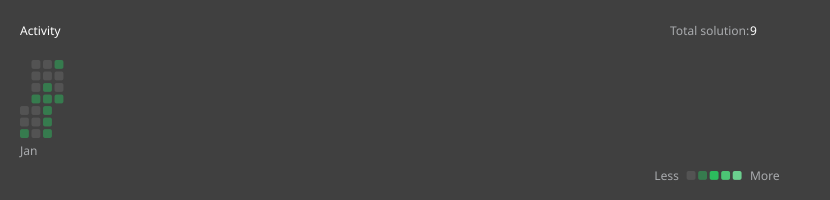

# All Submissions in 2026

## Overview

There are totally **29** questions have been solved in 2026, including **2** questions in easy, **15** questions in medium and **12** questions in hard.

Please click on the sections below to see more details for a specific month.
- [March](#march-submissions)

- [February](#february-submissions)

- [January](#january-submissions)

## March Submissions

Solved **5** questions in march:
- **0** questions in easy.
- **3** questions in medium.
- **2** questions in hard.

|   |Question Title|Difficulty|Source|
|:--|:-------------|:--------:|:-----|
|Day 12|[#3600. Maximize Spanning Tree Stability with Upgrades](https://leetcode.com/problems/maximize-spanning-tree-stability-with-upgrades/)|Hard|[src/q_3551_3600/q3600.cc](../src/q_3551_3600/q3600.cc)|
|Day 11||||
|Day 10|[#3130. Find All Possible Stable Binary Arrays II](https://leetcode.com/problems/find-all-possible-stable-binary-arrays-ii/)|Hard|[src/q_3101_3150/q3130.cc](../src/q_3101_3150/q3130.cc)|
|Day 9|[#3129. Find All Possible Stable Binary Arrays I](https://leetcode.com/problems/find-all-possible-stable-binary-arrays-i/)|Medium|[src/q_3101_3150/q3129.cc](../src/q_3101_3150/q3129.cc)|
|Day 8||||
|Day 7|[#1888. Minimum Number of Flips to Make the Binary String Alternating](https://leetcode.com/problems/minimum-number-of-flips-to-make-the-binary-string-alternating/)|Medium|[src/q_1851_1900/q1888.cc](../src/q_1851_1900/q1888.cc)|
|Day 6||||
|Day 5||||
|Day 4||||
|Day 3||||
|Day 2|[#1536. Minimum Swaps to Arrange a Binary Grid](https://leetcode.com/problems/minimum-swaps-to-arrange-a-binary-grid/)|Medium|[src/q_1501_1550/q1536.cc](../src/q_1501_1550/q1536.cc)|
|Day 1||||
## February Submissions

Solved **10** questions in february:
- **1** questions in easy.
- **4** questions in medium.
- **5** questions in hard.

|   |Question Title|Difficulty|Source|
|:--|:-------------|:--------:|:-----|
|Day 28||||
|Day 27|[#3666. Minimum Operations to Equalize Binary String](https://leetcode.com/problems/minimum-operations-to-equalize-binary-string/)|Hard|[src/q_3651_3700/q3666.cc](../src/q_3651_3700/q3666.cc)|
|Day 26||||
|Day 25||||
|Day 24||||
|Day 23||||
|Day 22||||
|Day 21||||
|Day 20|[#761. Special Binary String](https://leetcode.com/problems/special-binary-string/)|Hard|[src/q_751_800/q0761.cc](../src/q_751_800/q0761.cc)|
|Day 19||||
|Day 18||||
|Day 17||||
|Day 16||||
|Day 15||||
|Day 14||||
|Day 13|[#3714. Longest Balanced Substring II](https://leetcode.com/problems/longest-balanced-substring-ii/)|Medium|[src/q_3701_3750/q3714.cc](../src/q_3701_3750/q3714.cc)|
|Day 12|[#3713. Longest Balanced Substring I](https://leetcode.com/problems/longest-balanced-substring-i/)|Medium|[src/q_3701_3750/q3713.cc](../src/q_3701_3750/q3713.cc)|
|Day 11|[#3721. Longest Balanced Subarray II](https://leetcode.com/problems/longest-balanced-subarray-ii/)|Hard|[src/q_3701_3750/q3721.cc](../src/q_3701_3750/q3721.cc)|
|Day 10|[#3719. Longest Balanced Subarray I](https://leetcode.com/problems/longest-balanced-subarray-i/)|Medium|[src/q_3701_3750/q3719.cc](../src/q_3701_3750/q3719.cc)|
|Day 9||||
|Day 8||||
|Day 7||||
|Day 6|[#3634. Minimum Removals to Balance Array](https://leetcode.com/problems/minimum-removals-to-balance-array/)|Medium|[src/q_3601_3650/q3634.cc](../src/q_3601_3650/q3634.cc)|
|Day 5||||
|Day 4|[#3640. Trionic Array II](https://leetcode.com/problems/trionic-array-ii/)|Hard|[src/q_3601_3650/q3640.cc](../src/q_3601_3650/q3640.cc)|
|Day 3|[#3637. Trionic Array I](https://leetcode.com/problems/trionic-array-i/)|Easy|[src/q_3601_3650/q3637.cc](../src/q_3601_3650/q3637.cc)|
|Day 2|[#3013. Divide an Array Into Subarrays With Minimum Cost II](https://leetcode.com/problems/divide-an-array-into-subarrays-with-minimum-cost-ii/)|Hard|[src/q_3001_3050/q3013.cc](../src/q_3001_3050/q3013.cc)|
|Day 1||||
## January Submissions

Solved **14** questions in january:
- **1** questions in easy.
- **8** questions in medium.
- **5** questions in hard.

|   |Question Title|Difficulty|Source|
|:--|:-------------|:--------:|:-----|
|Day 31||||
|Day 30|[#2977. Minimum Cost to Convert String II](https://leetcode.com/problems/minimum-cost-to-convert-string-ii/)|Hard|[src/q_2951_3000/q2977.cc](../src/q_2951_3000/q2977.cc)|
|Day 29||||
|Day 28|[#3651. Minimum Cost Path with Teleportations](https://leetcode.com/problems/minimum-cost-path-with-teleportations/)|Hard|[src/q_3651_3700/q3651.cc](../src/q_3651_3700/q3651.cc)|
|Day 27|[#3650. Minimum Cost Path with Edge Reversals](https://leetcode.com/problems/minimum-cost-path-with-edge-reversals/)|Medium|[src/q_3601_3650/q3650.cc](../src/q_3601_3650/q3650.cc)|
|Day 26||||
|Day 25||||
|Day 24||||
|Day 23|[#3510. Minimum Pair Removal to Sort Array II](https://leetcode.com/problems/minimum-pair-removal-to-sort-array-ii/)|Hard|[src/q_3501_3550/q3510.cc](../src/q_3501_3550/q3510.cc)|
|Day 22|[#3507. Minimum Pair Removal to Sort Array I](https://leetcode.com/problems/minimum-pair-removal-to-sort-array-i/)|Easy|[src/q_3501_3550/q3507.cc](../src/q_3501_3550/q3507.cc)|
|Day 21|[#3315. Construct the Minimum Bitwise Array II](https://leetcode.com/problems/construct-the-minimum-bitwise-array-ii/)|Medium|[src/q_3301_3350/q3315.cc](../src/q_3301_3350/q3315.cc)|
|Day 20||||
|Day 19||||
|Day 18|[#1895. Largest Magic Square](https://leetcode.com/problems/largest-magic-square/)|Medium|[src/q_1851_1900/q1895.cc](../src/q_1851_1900/q1895.cc)|
|Day 17|[#3047. Find the Largest Area of Square Inside Two Rectangles](https://leetcode.com/problems/find-the-largest-area-of-square-inside-two-rectangles/)|Medium|[src/q_3001_3050/q3047.cc](../src/q_3001_3050/q3047.cc)|
|Day 16|[#2975. Maximum Square Area by Removing Fences From a Field](https://leetcode.com/problems/maximum-square-area-by-removing-fences-from-a-field/)|Medium|[src/q_2951_3000/q2975.cc](../src/q_2951_3000/q2975.cc)|
|Day 15|[#2943. Maximize Area of Square Hole in Grid](https://leetcode.com/problems/maximize-area-of-square-hole-in-grid/)|Medium|[src/q_2901_2950/q2943.cc](../src/q_2901_2950/q2943.cc)|
|Day 14|[#3454. Separate Squares II](https://leetcode.com/problems/separate-squares-ii/)|Hard|[src/q_3451_3500/q3454.cc](../src/q_3451_3500/q3454.cc)|
|Day 13|[#3453. Separate Squares I](https://leetcode.com/problems/separate-squares-i/)|Medium|[src/q_3451_3500/q3453.cc](../src/q_3451_3500/q3453.cc)|
|Day 12||||
|Day 11||||
|Day 10||||
|Day 9||||
|Day 8||||
|Day 7|[#1339. Maximum Product of Splitted Binary Tree](https://leetcode.com/problems/maximum-product-of-splitted-binary-tree/)|Medium|[src/q_1301_1350/q1339.cc](../src/q_1301_1350/q1339.cc)|
|Day 6||||
|Day 5||||
|Day 4||||
|Day 3|[#1411. Number of Ways to Paint N × 3 Grid](https://leetcode.com/problems/number-of-ways-to-paint-n-3-grid/)|Hard|[src/q_1401_1450/q1411.cc](../src/q_1401_1450/q1411.cc)|
|Day 2||||
|Day 1||||
